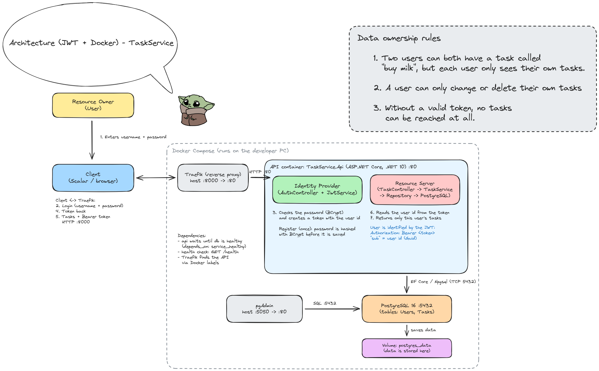

# C# Advanced – Arkitekturreview

A to-do API with login and JWT.

- Users register and log in to get a token.
- Each user only sees and changes their own tasks.
- Builds on week 2 (Docker, Traefik, PostgreSQL, EF Core).

## Authentication flow

The diagram is in `Excalidraw/AuthFlow.excalidraw` (and as an image in `Excalidraw/AuthFlow.png`). It shows the four roles:

| Role | In this project |
|---|---|
| **Resource Owner** | The user (e.g. daddy) who owns their tasks |
| **Client** | Scalar or curl, which sends the requests |
| **Identity Provider** | `AuthController` (`/auth/register` and `/auth/login`), which checks the password and creates the token |
| **Resource Server** | `TaskController` (`/tasks`), which reads the token and gives access to the right data |

```
1. POST /auth/register  →  the user is saved with a BCrypt hash of the password
2. POST /auth/login     →  the password is verified and the API returns a JWT
3. The client sends     Authorization: Bearer <token>
4. TaskController reads "sub" (user id) from the token
5. Service and repository filter on that id
```

## Data ownership rules

1. Two users can both have a task called "buy milk", but each user only sees their own tasks.
2. A user can only change or delete their own tasks.
3. Without a valid token, no tasks can be reached at all.

Another user's task gives **404 Not Found**, not 403. The user should not even know the task exists.

## Endpoints

| Method | Path | Token | Response |
|---|---|---|---|
| `POST` | `/auth/register` | No | `201` created, `400` missing fields, `409` username taken |
| `POST` | `/auth/login` | No | `200` with `{ "token": "..." }`, `401` wrong username or password |
| `GET` | `/auth/token` | Yes | `200` with header and claims from the token, `400` unreadable token |
| `GET` | `/tasks` | Yes | `200` own tasks only |
| `POST` | `/tasks` | Yes | `200` task is saved with the user's id |
| `PATCH` | `/tasks/{id}/complete` | Yes | `204` done, or `404` if the task is not yours |
| `DELETE` | `/tasks/{id}` | Yes | `204` done, or `404` if the task is not yours |

All `/tasks` endpoints return `401 Unauthorized` without a valid token.

## JWT

- The token is signed with **HS256** and a secret key from `appsettings.json` (`Jwt:Secret`).
- Claims: `sub` = user id (GUID), `unique_name` = username, `exp` = expiry time.
- The token lasts 60 minutes (`Jwt:ExpiresMinutes`).
- The key in `appsettings.json` is for local development only.
- The API checks the signature and the expiry time with `AddJwtBearer`. A fake or expired token gives `401`.

## Passwords

- Passwords are never stored in plain text.
- `PasswordHasher` uses **BCrypt.Net-Next**.
- Every hash has its own random salt, so the same password gives different hashes.

## Getting started

Requires **Docker Desktop**.

```powershell
docker compose up --build
```

Migrations run automatically on startup, so the `Tasks` and `Users` tables are created by themselves.

| What | Address |
|---|---|
| Scalar (API testing) | http://localhost:8000/scalar |
| Health check | http://localhost:8000/health |
| Traefik dashboard | http://localhost:8081 |
| pgAdmin | http://localhost:5050 |

## Testing in Scalar

1. `POST /auth/register` with `{ "username": "daddy", "password": "secret1234" }`
2. `POST /auth/login` with the same body. Copy the token (the text between the quotes).
3. Paste the token into **Authentication → Bearer Token**.
4. `GET /auth/token` shows `sub` and `unique_name`.
5. `POST /tasks` with `{ "title": "Buy milk" }`, then `GET /tasks`.
6. Register and log in another user (e.g. mommy), switch token and repeat. Each user only sees their own "Buy milk".

## Testing with curl

```powershell
$token = "<token from /auth/login>"
curl.exe -i "http://localhost:8000/tasks" -H "Authorization: Bearer $token"
curl.exe -i -X DELETE "http://localhost:8000/tasks/<id of another user's task>" -H "Authorization: Bearer $token"
curl.exe -i "http://localhost:8000/tasks"
```

Expected: `200` with own tasks, `404` on another user's task and `401` without a token.

## pgAdmin

**Login:** `admin@kh.com` / `admin`

**Connect to the database** (Add New Server → Connection):

| Field | Value |
|---|---|
| Host name/address | `db` |
| Port | `5432` |
| Maintenance database | `postgres` |
| Username | `postgres` |
| Password | `postgres` |

Check in the Query Tool on the `tasks` database:

```sql
SELECT "Id", "Title", "IsCompleted", "UserId" FROM "Tasks";
SELECT "Id", "Username", "PasswordHash" FROM "Users";
```

The tasks have different `UserId` values, and `PasswordHash` starts with `$2a$11$` (BCrypt).

## Tests

- The unit tests use `FakeTaskRepository`.
- They check that a user cannot see, complete or delete another user's tasks.
- The health check test needs `docker compose up` to be running.

```powershell
dotnet test
```

## Project structure

```
├── Excalidraw/            AuthFlow + Architecture (.excalidraw and .png)
├── TaskService.Api
│   ├── Controllers/       AuthController, TaskController
│   ├── Data/              TaskDbContext
│   ├── DTO/               CreateTaskRequest, RegisterRequest, LoginRequest
│   ├── Models/            User, TokenInfo
│   ├── Services/          JwtService, PasswordHasher, TokenReader (+ interfaces)
│   ├── Repositories/      EfTaskRepository
│   ├── Migrations/        EF Core migrations
│   ├── Program.cs
│   └── Dockerfile
├── TaskService.Core       TaskService, TaskItem, ITaskRepository, FakeTaskRepository
├── TaskService.test       Unit tests
├── docker-compose.yaml
└── adr.md                 Architecture Decision Record
```

## Architecture Review (module 3)

Four things in the system that could be better.



### 1. The token is not checked

**Problem:** The API reads the token, but never checks if it is real or expired.

**Consequence:** Anyone can make a fake token on jwt.io and see other users' tasks.

**Solution:** Use ASP.NET Core's built-in JWT check (`AddJwtBearer`) and `[Authorize]`.

**Priority:** High.

### 2. Passwords and secrets are on GitHub

**Problem:** The JWT secret and the database password are in `appsettings.json` and `docker-compose.yaml`, which are public on GitHub.

**Consequence:** Anyone who knows the secret can make valid tokens.

**Solution:** Move them to a `.env` file that is not pushed to GitHub.

**Priority:** High.

### 3. The database is open to the outside

**Problem:** Postgres, pgAdmin and the Traefik dashboard have open ports on the PC.

**Consequence:** You can go straight to the database and skip the API and its rules.

**Solution:** Remove the open ports, so only the API can talk to the database.

**Priority:** Medium.

### 4. AuthController talks directly to the database

**Problem:** `TaskController` uses service and repository, but `AuthController` uses the database directly.

**Consequence:** The code is not built the same way everywhere, and it is harder to test.

**Solution:** Add a `UserRepository`, like we have for tasks.

**Priority:** Low.

### What we fix

Problem 1 is fixed. See [adr.md](adr.md).